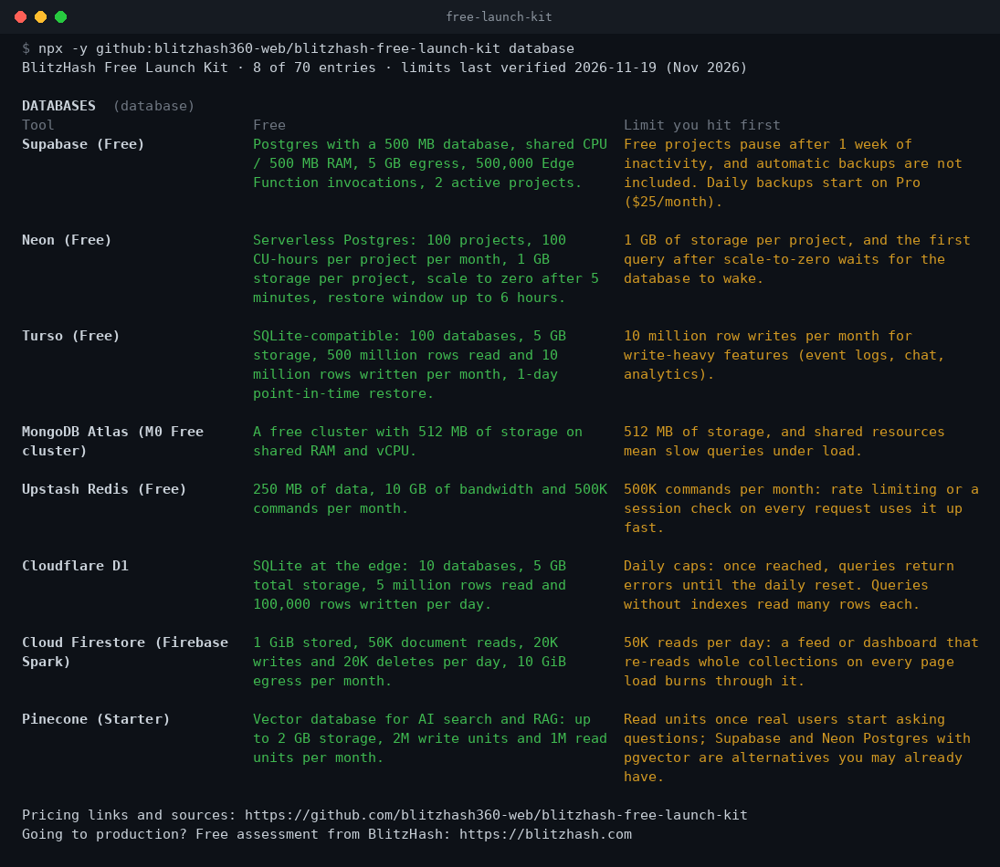

# BlitzHash Free Launch Kit [](https://awesome.re)

**Launch your AI-built app on free tiers without surprises: for every tool, what's free and the limit you hit first.**

[](https://github.com/blitzhash360-web/blitzhash-free-launch-kit/actions/workflows/ci.yml)
[](https://github.com/blitzhash360-web/blitzhash-free-launch-kit/actions/workflows/links.yml)
[](LICENSE)


Built your app with Lovable, Bolt, Replit, Cursor or v0? The free tiers of Supabase, Vercel, Cloudflare and friends can carry you a long way, but each one has a limit that bites first: a project that pauses after a week, a daily email cap, terms that forbid commercial use, no backups. This list puts that limit next to every free tier, so you know before your users do.

- **Curated, not exhaustive:** 70 tools across 12 categories that founders building with AI actually use.
- **Two facts per entry:** what's free (with the number) and the limit you hit first when you scale.
- **Verified:** every number was checked against the vendor's official pricing or limits page on **19 Nov 2026**, and each entry links that page. If a limit couldn't be confirmed, it's stated without a number or left out.



## Quick start

```bash
# 1. Browse every entry in your terminal (Node 18+, no install, no keys):
npx -y github:blitzhash360-web/blitzhash-free-launch-kit

# 2. Show one category (builders, hosting, database, auth, email, storage, monitoring, security, ai, analytics, jobs, extras):
npx -y github:blitzhash360-web/blitzhash-free-launch-kit database

# 3. Or search across everything (--json for scripts):
npx -y github:blitzhash360-web/blitzhash-free-launch-kit --search supabase
```

Prefer reading? The full list is below, and the same data lives in [`data/kit.json`](data/kit.json).

**How to read an entry:** `Name - Free: what you get at $0. Hits first: the limit or term that usually ends the free ride. (pricing)` links the official page the numbers came from.

<!-- kit:start (generated from data/kit.json by `npm run build`; edit the JSON, not this list) -->

## Contents

- [AI app builders (free plans)](#ai-app-builders-free-plans)
- [Hosting & deploy (free tiers)](#hosting--deploy-free-tiers)
- [Databases](#databases)
- [Auth & user accounts](#auth--user-accounts)
- [Email (transactional & marketing)](#email-transactional--marketing)
- [File storage & media](#file-storage--media)
- [Monitoring, errors & uptime](#monitoring-errors--uptime)
- [Security & scanners](#security--scanners)
- [AI APIs](#ai-apis)
- [Analytics & SEO](#analytics--seo)
- [Background jobs & cron](#background-jobs--cron)
- [Forms, payments & support](#forms-payments--support)

## AI app builders (free plans)

Where most AI-built apps start. The free plans are for trying, not launching.

- [Lovable](https://lovable.dev) - **Free:** Free plan with free credit grants, up to 5 lovable.app domains and invite-only publishing (up to 10 invited people per project). **Hits first:** Public launch: free projects only open for people you invite, so going live to real users needs a paid plan. ([pricing](https://lovable.dev/pricing))
- [Bolt](https://bolt.new) - **Free:** 300K tokens per day and 1M tokens per month, public and private projects, up to 3 collaborators. **Hits first:** The 300K daily token cap during long build sessions. Free sites also carry Bolt branding and uploads are capped at 10 MB. ([pricing](https://bolt.new/pricing))
- [v0](https://v0.app) - **Free:** Free access to v0 with a 7-message-per-day limit, deploys to Vercel, visual Design Mode and GitHub sync. **Hits first:** 7 messages a day. Deploys land on Vercel Hobby, which Vercel's terms limit to personal or non-commercial use. ([pricing](https://v0.app/pricing))
- [Cursor](https://cursor.com) - **Free:** Free plan with limited agent requests and limited chat requests (the pricing page does not publish a number). **Hits first:** Agent requests: a day of AI-assisted fixing uses up the free allowance; paid plans start at $8/month. ([pricing](https://cursor.com/pricing))

## Hosting & deploy (free tiers)

Put your app on the internet. Read the terms: some free tiers do not allow commercial use.

- [Vercel (Hobby)](https://vercel.com) - **Free:** 1M CDN requests, 100 GB Fast Data Transfer, 1M function invocations and 4 hours of Active CPU per month. **Hits first:** The terms, not the traffic: Hobby is for personal or non-commercial use only. Over a usage limit, that feature stops until 30 days have passed. ([pricing](https://vercel.com/pricing))
- [Netlify (Free)](https://www.netlify.com) - **Free:** 300 usage credits per month covering production deploys, compute, bandwidth, form submissions and web requests; 1 concurrent build. **Hits first:** The 300-credit hard cap: when one project reaches it, every project on the account is paused until the next cycle. ([pricing](https://www.netlify.com/pricing/))
- [Cloudflare Pages](https://developers.cloudflare.com/pages/) - **Free:** 500 builds per month, 1 build at a time, up to 20,000 files per site and 100 custom domains per project. **Hits first:** 500 builds a month if your AI tool pushes many small commits. Pages Functions count against the Workers Free limits. ([pricing](https://developers.cloudflare.com/pages/platform/limits/))
- [Cloudflare Workers](https://developers.cloudflare.com/workers/) - **Free:** 100,000 requests per day with 10 ms of CPU time per invocation; requests to static assets are not billed. **Hits first:** 10 ms of CPU per request: heavy server work (PDFs, image processing) fails. Workers Paid starts at $5/month. ([pricing](https://developers.cloudflare.com/workers/platform/pricing/))
- [Render (Free instances)](https://render.com) - **Free:** Free web services with 750 free instance hours per workspace per month, plus a free Postgres database. **Hits first:** Free services spin down after 15 minutes without traffic and take about a minute to wake; free Postgres databases expire 30 days after creation. ([pricing](https://render.com/docs/free))
- [Railway (Free)](https://railway.com) - **Free:** $1 of usage credit per month, services sleep and wake on request, up to 1 vCPU / 0.5 GB RAM per service and 0.5 GB volume storage. New accounts get a 30-day trial with $5 of credit. **Hits first:** $1 a month does not cover an always-on API plus a database; the Hobby plan is a $5 minimum. ([pricing](https://railway.com/pricing))
- [GitHub Pages](https://pages.github.com) - **Free:** Static sites from a repository: published sites up to 1 GB, a soft bandwidth limit of 100 GB per month, 10 builds per hour (no build limit with a custom Actions workflow). **Hits first:** Usage policy: GitHub does not allow Pages for an online business, e-commerce or SaaS. Static files only, no server code. ([pricing](https://docs.github.com/en/pages/getting-started-with-github-pages/github-pages-limits))
- [Firebase Hosting (Spark plan)](https://firebase.google.com/products/hosting) - **Free:** 10 GB of hosting storage and 360 MB per day of data transfer at no cost, custom domain and SSL included. **Hits first:** 360 MB of transfer per day: one busy day with large images or video reaches it. ([pricing](https://firebase.google.com/pricing))
- [Deno Deploy (Free)](https://deno.com/deploy) - **Free:** 1M requests and 20 GiB egress per month, 10 hours of Active CPU, 10 active apps, 5 custom domains, 1 GiB of KV storage. **Hits first:** Positioned for personal use and smaller projects; 1M requests per month and 15 builds per hour. ([pricing](https://deno.com/deploy/pricing))

## Databases

Where your users' data lives. Backups are usually the first thing a free tier leaves out.

- [Supabase (Free)](https://supabase.com) - **Free:** Postgres with a 500 MB database, shared CPU / 500 MB RAM, 5 GB egress, 500,000 Edge Function invocations, 2 active projects. **Hits first:** Free projects pause after 1 week of inactivity, and automatic backups are not included. Daily backups start on Pro ($25/month). ([pricing](https://supabase.com/pricing))
- [Neon (Free)](https://neon.com) - **Free:** Serverless Postgres: 100 projects, 100 CU-hours per project per month, 1 GB storage per project, scale to zero after 5 minutes, restore window up to 6 hours. **Hits first:** 1 GB of storage per project, and the first query after scale-to-zero waits for the database to wake. ([pricing](https://neon.com/pricing))
- [Turso (Free)](https://turso.tech) - **Free:** SQLite-compatible: 100 databases, 5 GB storage, 500 million rows read and 10 million rows written per month, 1-day point-in-time restore. **Hits first:** 10 million row writes per month for write-heavy features (event logs, chat, analytics). ([pricing](https://turso.tech/pricing))
- [MongoDB Atlas (M0 Free cluster)](https://www.mongodb.com/atlas) - **Free:** A free cluster with 512 MB of storage on shared RAM and vCPU. **Hits first:** 512 MB of storage, and shared resources mean slow queries under load. ([pricing](https://www.mongodb.com/pricing))
- [Upstash Redis (Free)](https://upstash.com) - **Free:** 250 MB of data, 10 GB of bandwidth and 500K commands per month. **Hits first:** 500K commands per month: rate limiting or a session check on every request uses it up fast. ([pricing](https://upstash.com/pricing/redis))
- [Cloudflare D1](https://developers.cloudflare.com/d1/) - **Free:** SQLite at the edge: 10 databases, 5 GB total storage, 5 million rows read and 100,000 rows written per day. **Hits first:** Daily caps: once reached, queries return errors until the daily reset. Queries without indexes read many rows each. ([pricing](https://developers.cloudflare.com/d1/platform/pricing/))
- [Cloud Firestore (Firebase Spark)](https://firebase.google.com/products/firestore) - **Free:** 1 GiB stored, 50K document reads, 20K writes and 20K deletes per day, 10 GiB egress per month. **Hits first:** 50K reads per day: a feed or dashboard that re-reads whole collections on every page load burns through it. ([pricing](https://firebase.google.com/pricing))
- [Pinecone (Starter)](https://www.pinecone.io) - **Free:** Vector database for AI search and RAG: up to 2 GB storage, 2M write units and 1M read units per month. **Hits first:** Read units once real users start asking questions; Supabase and Neon Postgres with pgvector are alternatives you may already have. ([pricing](https://www.pinecone.io/pricing/))

## Auth & user accounts

Sign-up, login and user management. Free limits are counted in monthly active users.

- [Supabase Auth](https://supabase.com/auth) - **Free:** 50,000 monthly active users on the Free plan. **Hits first:** It lives in your Supabase project, so it pauses with the project after 1 week of inactivity. ([pricing](https://supabase.com/pricing))
- [Clerk (Hobby)](https://clerk.com) - **Free:** 50,000 monthly retained users per app, prebuilt sign-up / sign-in / profile UIs, up to 3 dashboard seats. **Hits first:** Fixed 7-day session lifetime and 1-day log retention; SSO and more controls are on Pro. ([pricing](https://clerk.com/pricing))
- [Auth0 (Free)](https://auth0.com) - **Free:** Up to 25,000 monthly active users, passwordless login, social connections, 5 organizations, 1 custom domain. **Hits first:** B2B needs: 5 organizations and basic attack protection only. ([pricing](https://auth0.com/pricing))
- [Kinde (Free)](https://kinde.com) - **Free:** 10,500 monthly active users, email, SMS and social login, MFA, organizations, custom domain, subscriptions & billing. **Hits first:** 10,500 MAU, the lowest user cap in this section. ([pricing](https://kinde.com/pricing/))
- [WorkOS AuthKit](https://workos.com) - **Free:** User management free for up to 1 million active users. **Hits first:** Enterprise single sign-on (SAML / OIDC) is billed per connection, usually the first paid line when you sell to companies. ([pricing](https://workos.com/pricing))
- [Neon Auth](https://neon.com/docs/auth/overview) - **Free:** Managed Better Auth inside Neon, up to 60K monthly active users per project on Free. **Hits first:** Shares Neon's Free limits, including 1 GB of storage per project. ([pricing](https://neon.com/pricing))

## Email (transactional & marketing)

Password resets, receipts and newsletters. Daily send caps bite on launch day.

- [Resend (Free)](https://resend.com) - **Free:** 3,000 emails per month, 100 per day, 3 domains, 30-day data retention. **Hits first:** 100 emails per day: a launch-day signup spike or a batch of notifications stops sending. ([pricing](https://resend.com/pricing))
- [Postmark (Developer)](https://postmarkapp.com) - **Free:** 100 emails per month on the free Developer plan, which does not expire. **Hits first:** 100 per month covers testing only; the next tier is 10,000 per month. ([pricing](https://postmarkapp.com/pricing))
- [Brevo (Free)](https://www.brevo.com) - **Free:** Up to 300 emails per day once your account is approved for sending, plus a free SMTP server. **Hits first:** 300 emails per day: plan launch-day and newsletter sends around it. ([pricing](https://www.brevo.com/pricing/))
- [MailerSend (Free)](https://www.mailersend.com) - **Free:** 500 emails per month with email API, SMTP relay and drag-and-drop builder. **Hits first:** 500 per month: positioned for occasional testing and sending. ([pricing](https://www.mailersend.com/pricing))
- [Mailgun (Free)](https://www.mailgun.com) - **Free:** 100 emails per day, 1 custom sending domain, REST API and SMTP relay. **Hits first:** 100 per day and a single sending domain. ([pricing](https://www.mailgun.com/pricing/))
- [Loops (Free)](https://loops.so) - **Free:** Up to 1,000 subscribed contacts, 4,000 marketing sends per 30 days, transactional sends included. **Hits first:** 1,000 contacts; free emails carry a 'Powered by Loops' footer. ([pricing](https://loops.so/pricing))

## File storage & media

Uploads, images and video. Bandwidth and operations cost more than storage.

- [Cloudflare R2](https://www.cloudflare.com/developer-platform/products/r2/) - **Free:** 10 GB-month of storage, 1 million Class A and 10 million Class B operations per month; egress to the internet is free. **Hits first:** Class A operations (writes, lists) when an app uploads or lists many small files. ([pricing](https://developers.cloudflare.com/r2/pricing/))
- [Backblaze B2](https://www.backblaze.com/cloud-storage) - **Free:** The first 10 GB of storage is free; free egress up to 3x your monthly storage. **Hits first:** Egress above 3x what you store, e.g. a small set of popular videos. ([pricing](https://www.backblaze.com/cloud-storage/pricing))
- [Supabase Storage](https://supabase.com/storage) - **Free:** 1 GB of file storage with a 50 MB maximum upload size on the Free plan. **Hits first:** 1 GB total and 50 MB per file; file downloads share the project's 5 GB egress. ([pricing](https://supabase.com/pricing))
- [UploadThing](https://uploadthing.com) - **Free:** 2 GB of storage (shared between all your apps) and 7 days of audit log retention. **Hits first:** 2 GB shared across every app on the account. ([pricing](https://uploadthing.com/pricing))
- [Cloudinary (Free)](https://cloudinary.com) - **Free:** 25 credits per month and 3 users. 1 credit = 1,000 transformations or 1 GB of storage or 1 GB of image bandwidth. **Hits first:** Credits are shared across storage, bandwidth and transformations, so image-heavy pages use them fastest. ([pricing](https://cloudinary.com/pricing))
- [Vercel Blob (Hobby)](https://vercel.com/storage/blob) - **Free:** 1 GB of storage, 10K simple and 2K advanced operations, 10 GB of data transfer per month. **Hits first:** Same Hobby terms as Vercel hosting: personal or non-commercial use only. ([pricing](https://vercel.com/pricing))

## Monitoring, errors & uptime

Know your app is broken before your users tell you.

- [Sentry (Developer)](https://sentry.io) - **Free:** 1 user, 5k errors, 5M tracing spans, 50 session replays and 5 GB of logs per month. **Hits first:** 5k errors: one noisy bug can use the whole month, and only one person can log in. ([pricing](https://sentry.io/pricing/))
- [Better Stack (Free)](https://betterstack.com) - **Free:** Free for personal projects: 10 monitors & heartbeats, 1 status page, Slack and email alerts, 100,000 exceptions per month, 3 GB of logs. **Hits first:** Logs and traces are kept for 3 days only. ([pricing](https://betterstack.com/pricing))
- [UptimeRobot (Free)](https://uptimerobot.com) - **Free:** 50 monitors at a 5-minute interval (HTTP, port, ping, keyword); personal and commercial projects allowed. **Hits first:** 5-minute checks: short outages can go unnoticed. ([pricing](https://uptimerobot.com/pricing/))
- [Grafana Cloud (Free)](https://grafana.com/products/cloud/) - **Free:** All Grafana Cloud services with usage limits: 10k active metrics series, 14 days of retention for metrics, logs and traces. **Hits first:** 14-day retention and 10k active series once you add detailed metrics. ([pricing](https://grafana.com/pricing/))

## Security & scanners

Free protection and free checks. Use them before real users and real data arrive.

- [Cloudflare (Free plan)](https://www.cloudflare.com) - **Free:** DNS, unmetered DDoS protection, CDN, Universal SSL and the Free Managed Ruleset (WAF). **Hits first:** Meant for personal or hobby projects that aren't business-critical; no uptime SLA. ([pricing](https://www.cloudflare.com/plans/))
- [Cloudflare Turnstile](https://www.cloudflare.com/application-services/products/turnstile/) - **Free:** Free CAPTCHA alternative that blocks bots on signup, login and contact forms. **Hits first:** It only works if your server verifies the token on every submit; the widget alone protects nothing. ([pricing](https://www.cloudflare.com/application-services/products/turnstile/))
- [GitHub secret scanning & Dependabot](https://github.com/features/security) - **Free:** Dependabot alerts on every plan; secret scanning and code scanning are on by default for public repositories. **Hits first:** Private repositories need paid GitHub Secret Protection / Code Security for secret and code scanning. ([pricing](https://docs.github.com/en/get-started/learning-about-github/about-github-advanced-security))
- [Snyk (Free)](https://snyk.io) - **Free:** Dependency, code, IaC and container scanning: 200 open-source tests, 100 code tests, 300 IaC tests and 100 container tests per month. **Hits first:** 100 code tests per month if you scan on every push. ([pricing](https://snyk.io/plans/))
- [Semgrep (Free Edition)](https://semgrep.dev) - **Free:** Code and supply-chain scanning at $0 for up to 10 contributors. **Hits first:** The 10-contributor cap as the team grows. ([pricing](https://semgrep.dev/pricing))
- [Gitleaks](https://github.com/gitleaks/gitleaks) - **Free:** Open source (MIT): scans your whole git history for leaked API keys, locally or in CI. **Hits first:** It finds leaks; rotating the keys and cleaning history is still on you. ([pricing](https://github.com/gitleaks/gitleaks))
- [ZAP](https://www.zaproxy.org) - **Free:** Free, open-source web app security scanner (Apache-2.0). **Hits first:** Takes setup and judgement to read results; only scan apps you own. ([pricing](https://www.zaproxy.org))
- [MDN HTTP Observatory](https://developer.mozilla.org/en-US/observatory) - **Free:** Free scan and grade of a live site's security headers, no account needed. **Hits first:** Headers only: it can't see auth bugs, open database tables or leaked keys. ([pricing](https://developer.mozilla.org/en-US/observatory))
- [Qualys SSL Labs Server Test](https://www.ssllabs.com/ssltest/) - **Free:** Free online deep analysis of your HTTPS / TLS configuration. **Hits first:** TLS only; your hosting provider usually gets this right already. ([pricing](https://www.ssllabs.com/ssltest/))

## AI APIs

Free model access for prototypes. Rate limits and data-use terms matter more than price here.

- [Google Gemini API](https://ai.google.dev) - **Free:** Free tier on selected models with rate limits; some of the newest models are paid-only. **Hits first:** Data use: on the free tier your content is used to improve Google's products, so don't send customer data. Then rate limits. ([pricing](https://ai.google.dev/gemini-api/docs/pricing))
- [Groq](https://groq.com) - **Free:** Free plan with per-model limits on requests and tokens per minute and per day. **Hits first:** Requests per day on the model you picked; check the limits table before you build on one model. ([pricing](https://console.groq.com/docs/rate-limits))
- [OpenRouter](https://openrouter.ai) - **Free:** 25+ free models from 4 free providers behind one OpenAI-compatible API (model IDs ending in :free). **Hits first:** Free-model requests are capped per minute and per day; the daily cap rises after you buy credits. ([pricing](https://openrouter.ai/pricing))
- [Cloudflare Workers AI](https://developers.cloudflare.com/workers-ai/) - **Free:** 10,000 Neurons per day at no charge on both Free and Paid Workers plans. **Hits first:** The daily Neuron allowance (resets 00:00 UTC); beyond it you need Workers Paid. ([pricing](https://developers.cloudflare.com/workers-ai/platform/pricing/))

## Analytics & SEO

See who comes, what they do and how Google sees you.

- [PostHog](https://posthog.com) - **Free:** Every month: 1M analytics events, 5K session recordings, 1M feature-flag requests, 100K exceptions; 1 project, 1-year retention. **Hits first:** 5K session recordings once you have real traffic. ([pricing](https://posthog.com/pricing))
- [Cloudflare Web Analytics](https://www.cloudflare.com/web-analytics/) - **Free:** Free, privacy-first, lightweight web analytics. **Hits first:** Traffic stats only: no funnels or per-user product analytics. ([pricing](https://www.cloudflare.com/web-analytics/))
- [Vercel Web Analytics (Hobby)](https://vercel.com/docs/analytics) - **Free:** 50,000 events per month with a 1-month reporting window. **Hits first:** At 50,000 events collection pauses; Hobby teams can't buy more. ([pricing](https://vercel.com/docs/analytics/limits-and-pricing))
- [Umami Cloud (Hobby)](https://umami.is) - **Free:** Up to 100K events per month, 1 website, 6 months of data retention. **Hits first:** One website per account. ([pricing](https://umami.is/pricing))
- [Microsoft Clarity](https://clarity.microsoft.com) - **Free:** Free heatmaps and session recordings; Microsoft states there are no limits on traffic. **Hits first:** Recordings can capture what users type: mask sensitive fields and update your privacy policy. ([pricing](https://clarity.microsoft.com))
- [Google Analytics](https://marketingplatform.google.com/about/analytics/) - **Free:** Free web and app analytics; event-level data is kept for 2 or 14 months (2 by default). **Hits first:** The 2-month default retention: switch it to 14 months on day one. ([pricing](https://support.google.com/analytics/answer/7667196))
- [Google Search Console](https://search.google.com/search-console/about) - **Free:** Free service from Google: search queries, impressions, sitemap submission and indexing issues for your site. **Hits first:** Data only: it tells you what's wrong, fixing it is up to you. ([pricing](https://support.google.com/webmasters/answer/9128668))

## Background jobs & cron

Scheduled tasks, queues and CI minutes.

- [Upstash QStash (Free)](https://upstash.com/docs/qstash/overall/getstarted) - **Free:** HTTP message queue and scheduler: 1,000 messages per day. **Hits first:** 1,000 messages per day if every user action triggers a job. ([pricing](https://upstash.com/pricing/qstash))
- [cron-job.org](https://cron-job.org) - **Free:** Free scheduled HTTP calls, as often as once per minute, with execution history and failure notifications. **Hits first:** Your endpoint must be public and should check a secret, or anyone can trigger it. ([pricing](https://cron-job.org/en/))
- [GitHub Actions](https://github.com/features/actions) - **Free:** Standard runners in public repositories are free. Private repositories on GitHub Free get $12 of included compute per month (about 2,000 Linux minutes at $0.006 per minute) and 500 MB of artifact storage. **Hits first:** Private-repo minutes once you add tests, previews and scheduled jobs. ([pricing](https://docs.github.com/en/billing/concepts/product-billing/github-actions))

## Forms, payments & support

The small pieces every launch needs.

- [Tally](https://tally.so) - **Free:** Forms and submissions with no fixed cap (fair-usage guidelines apply), payments, file uploads, webhooks and integrations. **Hits first:** Tally branding and no custom domain on free. ([pricing](https://tally.so/pricing))
- [Formspree (Free)](https://formspree.io) - **Free:** Form backend for static sites: 50 submissions per month. **Hits first:** 50 submissions per month, and the dashboard only shows the last 30 days. ([pricing](https://formspree.io/plans))
- [Crisp (Free)](https://crisp.chat) - **Free:** Website chat widget and shared inbox with 2 seats. **Hits first:** No AI credits on free, and 2 seats. ([pricing](https://crisp.chat/en/pricing/))
- [Stripe](https://stripe.com) - **Free:** No setup or monthly fees; standard US card pricing is 2.9% + 30¢ per successful charge. **Hits first:** Not free, pay-per-transaction: model fees into your price before launch. ([pricing](https://stripe.com/us/pricing))

*70 entries in 12 categories. Every limit was checked against the vendor's official pricing or limits page on 2026-11-19 (last verified: Nov 2026).*

<!-- kit:end -->

## Outgrowing free tiers?

Free tiers end in a few predictable ways. Plan for these before launch day:

- **Pauses and hard caps.** Some free plans stop serving when you hit a limit (Netlify pauses every project on the account, Vercel Hobby features wait 30 days, Supabase pauses inactive projects, D1 returns errors after the daily cap). Know which of yours fail closed, and put a status page and uptime monitor in front of them.
- **Terms, not traffic.** Vercel Hobby and GitHub Pages don't allow commercial use or online businesses. The day you take payments, you're on the wrong plan regardless of traffic.
- **Cost cliffs.** The jump from $0 is rarely gradual: a minimum plan fee, per-seat pricing, or a usage meter that starts at the first unit over the allowance. Set spend alerts and caps on day one.
- **Backups are often missing.** Many free database tiers include no automatic backups, or keep restore points for only hours or a day. Export your data on a schedule and test a restore before real users arrive.
- **The cheapest path is often not another SaaS.** Past a certain size, one small server running self-hosted Postgres, storage and email relay can cost less than five separate paid tiers. Do the maths before you upgrade everything.

## Going to production? What free tiers don't cover

A free tier gives you infrastructure. It doesn't check what your AI tool built on top of it. Before real users and real data:

1. **Plan for pauses and limits:** map every free limit in your stack, what happens when it's hit, and which upgrade you'd need.
2. **Find the cost cliffs:** estimate your bill at 10x and 100x today's traffic, and set spend caps and alerts.
3. **Backups you've tested:** automatic backups, an off-site copy, and a restore you've actually run.
4. **Security review:** database access rules (Supabase RLS), keys exposed in the browser, unsigned payment webhooks, missing rate limits and security headers.
5. **Scaling:** slow queries and missing indexes, background jobs, caching, and what moves first when traffic grows.

That's the part a senior engineering team does. **BlitzHash offers a free assessment: https://blitzhash.com**

Free tools from BlitzHash that help with some of these steps: [blitzhash-security-review](https://github.com/blitzhash360-web/blitzhash-security-review), [blitzhash-secret-guard](https://github.com/blitzhash360-web/blitzhash-secret-guard), [blitzhash-cloud-cost-cutter](https://github.com/blitzhash360-web/blitzhash-cloud-cost-cutter).

## How entries are verified

- Every number comes from the vendor's own pricing, limits or terms page, fetched on 19 Nov 2026. The `pricing` link on each entry is that page.
- Vendors change free tiers often. Each entry in [`data/kit.json`](data/kit.json) is dated by the file's `lastVerified` field; always check the pricing link before you commit to a plan.
- Link health is checked by CI on every push and every week ([links workflow](.github/workflows/links.yml)), and `npm test` fails if the README and `data/kit.json` drift apart.
- Spotted an outdated limit? Open an issue or a PR with the official pricing URL. See [CONTRIBUTING.md](CONTRIBUTING.md).

## Contributing

PRs are welcome. Each entry needs the official pricing URL and both facts (what's free, and the limit you hit first). Read [CONTRIBUTING.md](CONTRIBUTING.md), edit `data/kit.json`, run `npm run build && npm test`.

## Credits

- Inspired by **[free-for-dev](https://github.com/ripienaar/free-for-dev)** by R.I. Pienaar and contributors, the long-running list of free tiers for developers. Go there for breadth. This kit is a short, opinionated companion for non-technical founders; every entry here was written and verified by BlitzHash, and no text was copied from free-for-dev.
- Numbers and terms belong to their vendors and were taken from their official pages. This project is independent and not affiliated with or endorsed by any vendor listed.

## License

[MIT](LICENSE) for the BlitzHash content and code in this repository. Vendor names and trademarks belong to their owners.

---

**Built by BlitzHash: need a senior team to check or scale your AI-built app? Free assessment at https://blitzhash.com**
